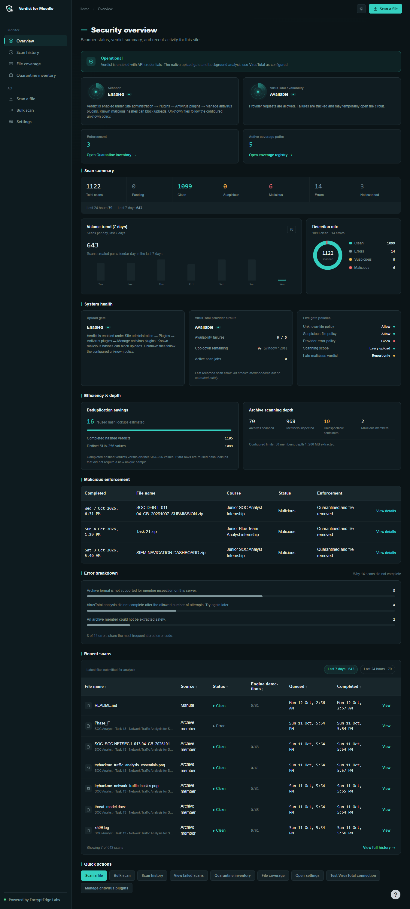
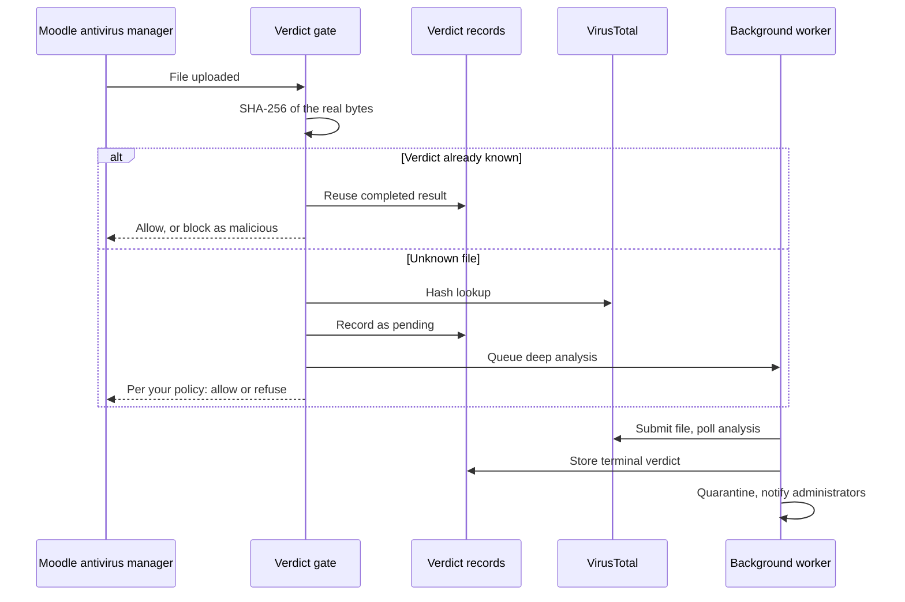
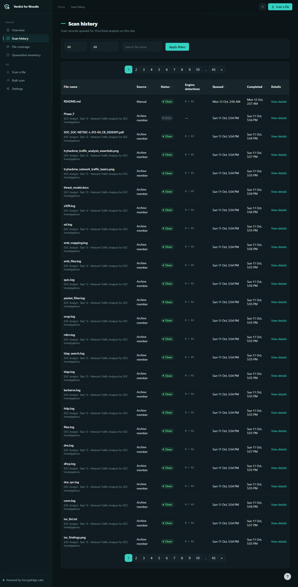
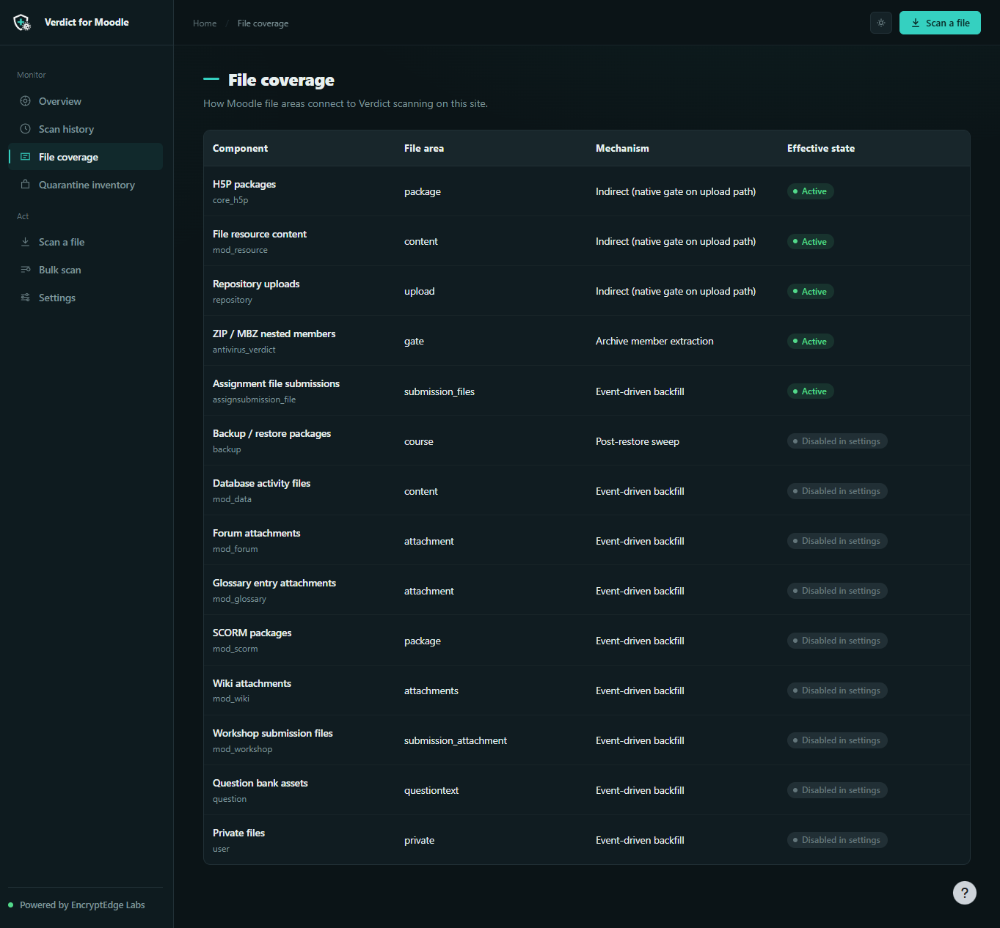
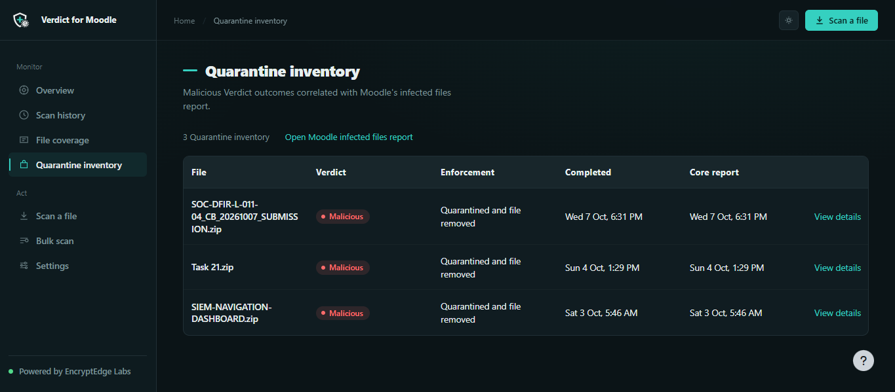

# Verdict for Moodle

### Every upload gets a verdict. Every verdict is enforced.

**Native Moodle antivirus, powered by VirusTotal. Built for sites that cannot afford to guess.**

`antivirus_verdict` · Release 1.0.0 (build `2026101100`) · Moodle 4.5 – 5.2 · GPL-3.0-or-later

*Maintained by [EncryptEdge Labs Limited](https://github.com/EncryptEdge-Labs)*

---

## Why Verdict exists

A learning platform accepts files from hundreds or thousands of people: assignment submissions, forum attachments, SCORM packages, course backups, H5P content. Any of those files can carry malware, and in most Moodle sites nobody can say which files were checked, what the result was, or what happened to the bad ones.

Verdict answers all three questions, on every site, with evidence.

It plugs into Moodle's own antivirus manager, so protection starts at the upload gate rather than after the fact. Every file is hashed and checked against VirusTotal's global analysis network. Unknown files are analysed in the background without blocking your users. Confirmed malware is quarantined and removed from the live file pool. Administrators see all of it in a dedicated security console.

Verdict is a **Moodle security product**. It is not workstation antivirus, and it is not a VirusTotal widget pasted into Moodle. Hashing, policy, persistence, archive inspection, attribution and enforcement are all Verdict's own work. VirusTotal is the analysis engine behind it.

---

## What happens to a file

The upload request never waits for a full analysis, so your users keep working. The decision is still made, recorded and enforced.

---

## What makes Verdict different

**Unknown is never clean.** Pending, unknown, rate-limited, provider-unavailable and not-scanned results are never displayed or reused as clean for a security decision. Verdict is built on this rule, and the interface, the database and the policy engine all follow it.

**Failures are not silently waved through.** Moodle core treats a scanner error as fail-open. Verdict's default provider-error policy is **Block**, which refuses the upload by raising a scanner exception. You can choose to report-only instead, but that has to be your decision.

**Late enforcement is verified, not assumed.** When an analysis finishes as malicious after the upload, Verdict locates the *live* Moodle file by File API identity and confirms both its content hash and its SHA-256 before it acts. Only then does it quarantine the file through Moodle's own quarantine system, fire the core infected-file event, notify administrators and remove the verified file. A copy is never mistaken for the real file.

**Archives are inspected, not trusted.** A clean outer hash does not mean a clean ZIP. Verdict can open ZIP and MBZ files and scan their members within strict limits on member count, nesting depth, extracted size and time. If a limit is hit or a format cannot be inspected, the result is *error*, never *clean*. If any member is malicious, the parent file is enforced.

**Your key stays yours.** The VirusTotal API key is stored in plugin configuration only. It is never written to scan rows, task payloads, routine logs or ordinary plugin pages.

---

## Capabilities

| Capability | What you get |
| --- | --- |
| **Native upload gate** | Runs on Moodle's antivirus manager paths: repository upload, file pool moves, web service upload, H5P and similar |
| **Synchronous hash lookup** | Known-malicious files are blocked at upload time. Known-clean results are reused instantly |
| **Background analysis** | Unknown files are uploaded to VirusTotal and polled to completion (large files via VirusTotal upload URLs) |
| **Policy engine** | Separate, configurable policies for unknown, suspicious, provider-error and late-malicious outcomes |
| **Late enforcement** | Verified quarantine and removal of malicious files through Moodle's core quarantine |
| **Archive scanning** | ZIP and MBZ member inspection with bounded, fail-safe limits |
| **Deduplication** | Identical files share one verdict, saving your VirusTotal quota |
| **Resilience** | Retries with Retry-After handling, HTTP 429 queueing, stale-job recovery and an availability circuit breaker |
| **Operation ceilings** | Optional site-wide limits on lookups, uploads and polls to protect your API plan |
| **Backfill scanning** | Optional automatic scanning of assignment submissions, forum, workshop, glossary, database, wiki, SCORM, question bank, restores and private files |
| **Manual and bulk scan** | Scan a single file on demand, or sweep a course's stored files in bounded batches |
| **Administrator alerts** | Moodle messages (HTML and plain text) on malicious, suspicious or error outcomes |
| **Teacher access** | Optional, administrator-controlled visibility of selected Verdict pages, scoped to the teacher's own courses |
| **Privacy and retention** | Privacy API export and delete of plugin-owned data, plus scheduled history purge |

---

## The operator console

Verdict ships with a purpose-built console in light and dark themes. It gives administrators the full picture without digging through logs.

| | |
| --- | --- |
| **Security overview** Protection status, scan totals, detection mix, 7-day volume, provider health, live policies, deduplication savings, archive depth, enforcement table and error breakdown | **Scan history** Filterable record of every scan, with source, status, engine detections and full detail pages including attribution and related scans |
| **File coverage** A registry showing exactly which Moodle file areas are protected on your site, and how | **Quarantine inventory** Every malicious verdict and its enforcement outcome, correlated with Moodle's infected-files report |
| **Manual and bulk scan** On-demand scanning of a single file or an entire course | **Settings** Credentials, scan scope, policies, archive limits, notifications, retention and teacher access in one place |

---

## Default policies

| Policy | Default | If set to Block | If set to Allow or Report |
| --- | --- | --- | --- |
| **Unknown file** | Allow | Refuse the upload, without claiming it is malware | Upload continues; scan stays pending |
| **Suspicious** | Allow | Refuse the upload, without claiming confirmed malware | Upload continues; recorded as suspicious |
| **Provider error** | **Block** | Refuse the upload | Report the error; Moodle may still accept the file |
| **Late malicious** | Quarantine | Quarantine and delete the verified live file | Record the finding without deleting anything |

---

## Built for production

- **Availability circuit breaker.** Five consecutive availability failures open the circuit for 120 seconds, and a single half-open probe decides when to resume. Your upload gate never hammers a struggling provider.
- **Rate-limit aware.** HTTP 429 responses queue the file as pending (never as malware, never as clean), honour Retry-After up to a one-hour cap, and retry up to ten times.
- **Self-healing.** A scheduled task recovers scans stuck in flight, re-queueing or failing them so nothing is left without a worker.
- **Cross-version.** One codebase supports Moodle 4.5, 5.0, 5.1 and 5.2, including the move to the `public/` directory layout.
- **Quota-efficient.** Completed hash reuse and joining an in-flight analysis consume no lookup or upload budget, and shared polling makes one provider call per analysis.
- **Accountable.** Every scan records who and what triggered it (submission, uploader, operator), and missing context is shown as *Not available* instead of being invented.

---

## Verified, not just claimed

| Evidence | Result |
| --- | --- |
| PHPUnit suite `antivirus_verdict_testsuite` | **556 tests** per supported branch, using mocks and fakes (6 skips, including the opt-in live VirusTotal test) |
| Behat scenarios `@antivirus_verdict` | **18** functional scenarios per branch |
| Live VirusTotal certification | Available to operators on request, never part of default CI |

The full evidence trail is in [`CHANGES.md`](CHANGES.md). Verdict's own documentation states what the tests do and do not cover, so you never have to infer it.

---

## Honest boundaries

Verdict is a serious security product, and serious products state their limits.

- **Moodle core decides what gets scanned.** Verdict protects every path that goes through Moodle's antivirus manager. Direct `file_storage` writes that never call the manager are outside any antivirus plugin's reach. That is Moodle core behaviour.
- **VirusTotal is the provider.** Each site supplies its own API key and plan. Verdict does not include quota, hosted keys or guaranteed detection, and it cannot retract data already sent to VirusTotal.
- **Archive scanning covers ZIP and MBZ.** Other container formats are reported as uninspectable, never as clean.
- **SQL Server.** Site operation ceilings are not enforced on SQL Server because atomic reservation is not available there.
- **Not endpoint antivirus.** Verdict protects your Moodle content, not workstations.

---

## Requirements

| | |
| --- | --- |
| **Moodle** | 4.5, 5.0, 5.1 or 5.2 |
| **PHP** | The version Moodle documents for your branch |
| **Database** | Any database supported by Moodle (see the SQL Server note above) |
| **VirusTotal** | A site-owned API v3 key and outbound HTTPS |
| **Optional** | PHP `ZipArchive`, if archive scanning is enabled |

## Installation

1. Copy the plugin into a folder named **`verdict`**:
   - Moodle 4.5 / 5.0: `{moodleroot}/lib/antivirus/verdict/`
   - Moodle 5.1 / 5.2: `{moodleroot}/public/lib/antivirus/verdict/`
2. Open **Site administration → Notifications** to complete the install.

Or install the release ZIP through **Site administration → Plugins → Install plugins**. The folder name must be `verdict`.

## Configuration

1. **Add your key.** Go to Site administration → Plugins → Antivirus plugins → **Verdict for Moodle** and save your VirusTotal API key.
2. **Switch it on.** Go to Site administration → Plugins → Antivirus plugins → **Manage antivirus plugins** and enable **Verdict**. Moodle's list is the only master switch.
3. **Choose your policies** for unknown, suspicious, provider-error and late-malicious outcomes.
4. **Optionally** turn on archive scanning, activity backfill, notifications, retention and teacher access.

After upgrades that change tasks or templates, run **Purge all caches**.

---

## Security and support

- **Report a vulnerability** privately by following [`SECURITY.md`](SECURITY.md). Please never post API keys, customer files or live malware in public issues.
- **Commercial support, implementation and operational agreements** are provided by EncryptEdge Labs Limited through your agreement or the channel named in your contract. This repository contains GPL source, not a hosted service.

## Documentation

| Document | Purpose |
| --- | --- |
| [`docs/FEATURES.md`](docs/FEATURES.md) | Exact feature behaviour, settings and limitations |
| [`docs/ARCHITECTURE.md`](docs/ARCHITECTURE.md) | Gate, async engine, circuit breaker, enforcement and data model |
| [`docs/ROADMAP.md`](docs/ROADMAP.md) | Release status, known limits and planned work |
| [`CHANGES.md`](CHANGES.md) | Release notes and verification evidence |

## Licence

Copyright 2026 M. AFZAL RIAZ, powered by EncryptEdge Labs Limited.

Released under the **GNU General Public License v3.0 or later**. See [LICENSE](LICENSE). The GPL covers the source code. "Verdict", "Verdict for Moodle" and EncryptEdge Labs marks remain product names and are not licensed for use on forks.
