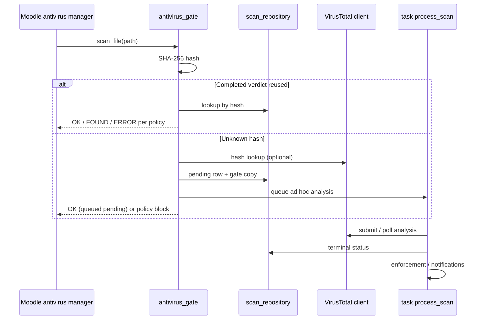

# Verdict for Moodle — Architecture

Technical description of the **implemented** plugin (`antivirus_verdict`, install folder **`verdict`**, release **1.0.0**, build **`2026101100`**). Observable behaviour and settings: [`FEATURES.md`](FEATURES.md).

## Purpose and boundaries

Verdict is a Moodle **antivirus plugin** that integrates with `\core\antivirus\manager` on supported upload paths, uses **VirusTotal API v3** as the external analysis provider, persists scan state in the site database, and provides an administrator (and optionally teacher) product UI.

Verdict is **not** endpoint antivirus, not a guarantee that every file in Moodle was scanned, and not a replacement for Moodle’s native “Manage antivirus plugins” enablement.

## Moodle integration

| Item | Value |
| ---- | ----- |
| Component | `antivirus_verdict` |
| Type | Antivirus (`lib/antivirus/verdict/`) |
| Layout | `{moodleroot}/lib/antivirus/verdict/` on 4.5/5.0; `{moodleroot}/public/lib/antivirus/verdict/` on 5.1/5.2 |
| Requires | Moodle 4.5 (`2024100700`) |
| Supported | Branches **405–502** (4.5, 5.0, 5.1, 5.2) |
| Enablement | `$CFG->antiviruses` / Manage antivirus plugins (no separate master switch) |

Discovery uses standard plugin files: `version.php`, `settings.php`, `db/install.xml`, `db/upgrade.php`, `db/tasks.php`, `db/hooks.php`, `db/events.php`, `db/messages.php`, `db/caches.php`, `db/access.php`.

Primary navigation hook: `\core\hook\navigation\primary_extend` → `hook_callbacks::extend_primary`.

## Core modules

| Area | Role |
| ---- | ---- |
| `classes/scanner.php` | Moodle `\core\antivirus\scanner` adapter |
| `classes/local/antivirus_gate.php` | Synchronous hash-lookup gate |
| `classes/local/scan_service.php` | Async analysis, polling, archives, notifications |
| `classes/provider/virustotal/client.php` | VirusTotal API v3 client |
| `classes/local/provider_health.php` | Availability circuit (cache-backed) |
| `classes/local/retry_policy.php` | Retry budget, delays, Retry-After cap |
| `classes/local/malicious_enforcer.php` | Late malicious File API enforcement |
| `classes/local/scan_repository.php` | Scan row persistence |
| `classes/local/scan_context_resolver.php` | Attribution for UI / privacy |
| `classes/task/*` | Ad hoc and scheduled workers |
| `classes/observer.php` | Activity / restore events |
| `classes/privacy/provider.php` | Privacy API |
| `classes/local/operation_reservation.php`, `operation_counts.php` | Optional operation ceilings |

Product UI loads `styles.css`, `javascript/ui.js`, and `javascript/theme-boot.js` from `page::apply_chrome()` because antivirus plugins are not in the standard theme CSS bundle.

## Scan lifecycle (high level)

### Synchronous gate

`antivirus_gate::scan_file()` hashes bytes, uses a per-hash lock, reuses **completed** verdicts when present, otherwise calls VirusTotal lookup when configured. Returns `SCAN_RESULT_OK`, `SCAN_RESULT_FOUND`, or `SCAN_RESULT_ERROR`. Unknown hashes become **pending** and queue `process_scan` when a gate file copy can be stored. Transient unavailability (429, circuit open) queues pending rather than claiming malware. Unknown, pending, and provider-error outcomes are **never** mapped to clean.

`scanner::is_configured()` is true when an API key exists; Moodle must also list `verdict` in `$CFG->antiviruses`. Capability checks are **not** applied inside `scan_file()` (system service).

### Asynchronous analysis

`task\process_scan` continues lookup, submission (direct ≤32 MiB, upload URL above), polling, retries, archive orchestration, administrator notifications, and late enforcement.

Scheduled **`recover_stale_scans`** re-queues or fails stuck rows (`STALE_REQUEUE_AFTER` 7200s, `STALE_FAIL_AFTER` 86400s). Moodle 5.1/5.2 delay the running ad hoc task; 4.5/5.0 queue a delayed successor so pending work is not orphaned.

Retryable error codes include network, server, rate limit, generic, provider unavailable, upload interrupted (max **10** attempts; Retry-After capped at **3600**s).

### Circuit breaker

`provider_health`: **closed** / **open** / **half-open**. **5** consecutive availability failures open the circuit for **120** seconds. Half-open allows one probe (lock-serialised). Auth and malformed-success do **not** open the circuit. Cache miss behaves as closed.

### VirusTotal client

API v3; key sent only as `x-apikey` server-side. Connect timeout **10**s, request timeout **20**s, large upload **60**s. Host-validated upload URLs for large files. HTTP **429** → `error_ratelimit`.

Optional site ceilings (`lookupceiling`, `uploadceiling`, `pollceiling`; `0` = unlimited) use reservation + lifetime counters; hash reuse and joining in-flight analysis do not consume lookup/upload budget.

## Archives

Optional (`archivescan`, on by default on new installs). **ZIP/MBZ** via PHP `ZipArchive` only. Bounded: default **50** members, depth **1**, **200** MB extracted, per-member limits, **120**s work budget. Uninspectable containers are **error/incomplete**, never silent clean. Aggregate precedence: malicious > suspicious > error > pending/not scanned > clean. Member rows use `parentscanid`; malicious **members** do not quarantine themselves—the **parent** live Moodle file is enforced when the aggregate is malicious.

## Backfill (not the upload gate)

Observers queue optional activity scans (assignment, forum, workshop, glossary, database, wiki, SCORM, question bank), course restore, and private-files sweep. Same async path as manual scan; deduplication avoids duplicate provider work when the gate already recorded a verdict.

## Late enforcement

After async **malicious** completion, `malicious_enforcer` resolves the **live** file by File API identity, verifies `contenthash` and SHA-256, quarantines via core `\core\antivirus\quarantine`, emits `virus_infected_file_detected`, notifies via core antivirus messaging, then deletes only a verified matching live file. Plugin `manual` / `gate` copies are never treated as the live file.

## Database

Primary table **`antivirus_verdict_scans`** (`db/install.xml`, XMLDB version **2026092801**). Supporting: **`antivirus_verdict_opcounts`**, **`antivirus_verdict_opreserve`**. Upgrade savepoints through **`2026101100`** (`db/upgrade.php`; latest step is presentation-only).

Key concepts on scan rows: status, phase, hash, source, File API identity, `userid`, `initiatedby`, `submissionid`, enforcement, parent scan, timestamps, provider ids (not the API key).

**SQL Server note:** atomic ceiling reservation returns `-1`; site operation ceilings are not enforced on that DB family (documented limitation).

## Tasks

| Task | Schedule |
| ---- | -------- |
| `recover_stale_scans` | Every minute (randomised minute) |
| `purge_scan_history` | Daily 03:15 |
| `scan_private_files` | Hourly at :45 (when enabled) |

Ad hoc: `process_scan`, archive processing, bulk/manual queue workers (see `classes/task/`).

## Security model

* **Capabilities** gate product pages and actions (`manage`, `scan`, `viewreports`, `viewhistory`, `rescan`); teacher visibility additionally controlled by `teacheraccess` settings.
* **API key** stored in plugin config only; not written to scan rows, task payloads, ordinary logs, or standard page exports.
* **Output** via Mustache + `s()` / presenter helpers; admin-only key reveal on Settings after sesskey confirmation.
* **Privacy API** exports/deletes plugin-owned rows and copies; does not delete VirusTotal cloud data or original activity files.

## UI state (overview radars)

CSS animation is driven by template flags from `overview_service`:

* **Scanner radar:** `scanner_radar_active()` → plugin enabled in Manage antivirus plugins **and** API key saved.
* **Provider radar:** `provider_radar_active()` → API key saved **and** circuit **closed**.

Reduced motion and misconfiguration pause animation (`is-paused`).

## Compatibility approach

Single codebase for 4.5–5.2; branch differences mainly ad hoc task scheduling and public dirroot layout. PHPUnit and Behat should run on **branch-appropriate PHP** (8.3 for 4.5/5.1, per Moodle requirements).

Direct `file_storage` writes that never invoke `\core\antivirus\manager` are outside Verdict’s gate (Moodle core behaviour).
